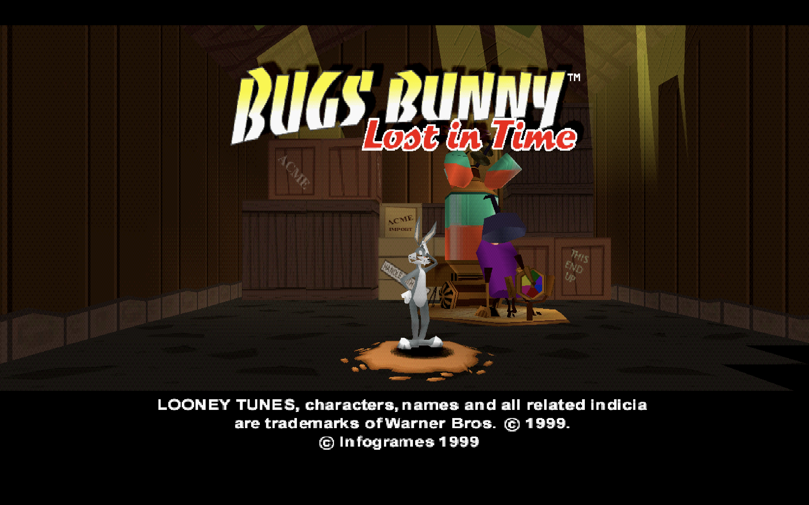
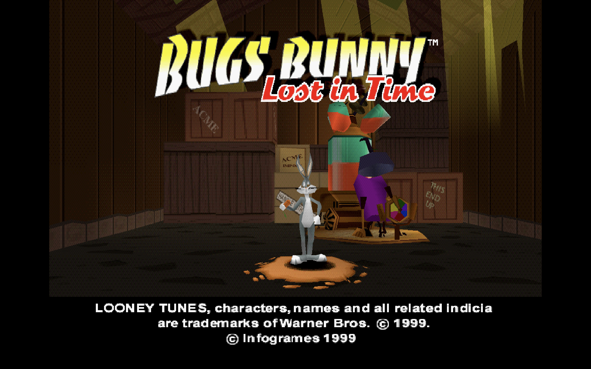
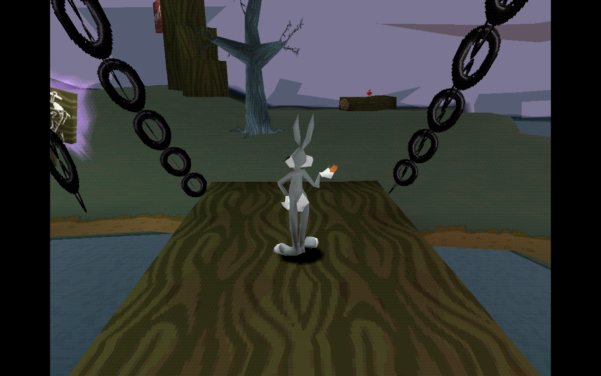
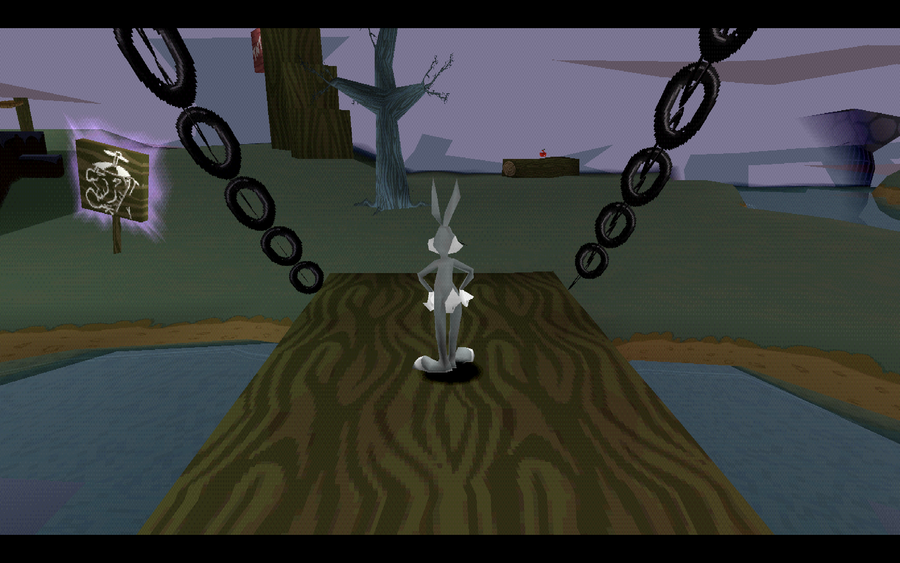

# Bugs Bunny: Lost in Time Recompiled

**Bugs Bunny's 1999 time-travel adventure, recompiled for modern systems. Now in native 16:9.**

*Bugs Bunny: Lost in Time* (PlayStation, 1999), statically recompiled into a
native executable for Windows, Linux and macOS, with optional native
widescreen.

<!-- retcomm-readme-metrics -->
[](https://github.com/PeriBluGaming/BugsBunnyLostinTimeRecomp/releases)
[](https://github.com/PeriBluGaming/BugsBunnyLostinTimeRecomp/releases/latest)
[](https://github.com/PeriBluGaming/BugsBunnyLostinTimeRecomp/releases/latest)
<!-- /retcomm-readme-metrics -->



## Highlights

- **Native recompilation**: the game's PlayStation code is translated to C
  ahead of time and compiled into a native program, built on psxrecomp.
- **Native 16:9 widescreen**: an optional mod that renders a wider view of the
  world instead of stretching the 4:3 picture.
- **Widescreen HUD**: in 16:9, the corner HUD moves out to the wide screen
  edges.
- **Original 4:3 whenever you want it**: widescreen is a mod that is off by
  default.
- **No retail BIOS needed**: the open-source OpenBIOS is bundled.

> [!IMPORTANT]
> **You need your own copy of the game.** Bugs Bunny: Lost in Time
> Recompiled contains no disc image and no retail BIOS. You supply a disc
> image of the North American (USA) release (SLUS-00838).

## 4:3 vs. Native 16:9 Widescreen

Native widescreen renders a wider view of the scene: the scenery that the
original 4:3 picture cuts off at the sides is actually drawn. Nothing is
stretched, so Bugs and the world keep their original proportions.

### Title Screen

<table>
  <tr>
    <th width="50%">Original 4:3</th>
    <th width="50%">Native 16:9</th>
  </tr>
  <tr>
    <td valign="top"></td>
    <td valign="top"></td>
  </tr>
</table>

### Gameplay

<table>
  <tr>
    <th width="50%">Original 4:3</th>
    <th width="50%">Native 16:9</th>
  </tr>
  <tr>
    <td valign="top"></td>
    <td valign="top"></td>
  </tr>
</table>

<sub>Screenshots of the game window, scaled proportionally: not cropped or
stretched. The gameplay shots were taken at slightly different moments. Game
content belongs to its rights holders and is not covered by any license of
this project.</sub>

## About

Bugs Bunny: Lost in Time Recompiled (this repository:
BugsBunnyLostinTimeRecomp) is an unofficial, fan-made static recompilation. It is not an emulator: the game's original PlayStation code is
translated into C ahead of time and compiled into a native program. It is
built on [psxrecomp](https://github.com/mstan/psxrecomp), which provides the
recompiler and the runtime that stands in for the PlayStation hardware, and
[recomp-ui](https://github.com/RetroPortingToolKit/recomp-ui), which provides
the launcher. Game data is read from your own disc image.

| | |
|---|---|
| Game | Bugs Bunny: Lost in Time |
| Region / serial | USA (NTSC-U) · SLUS-00838 |
| Boot executable | `SLUS_008.38` |
| Players | 1 |
| Publisher | Infogrames |
| Original release | 1999, PlayStation |

## Features

This README describes **Bugs Bunny: Lost in Time Recompiled v0.2.0**. The
widescreen enhancements are part of the bundled **Widescreen 16:9** mod and
are off by default.

| Enhancement | What it does |
|---|---|
| **Native 16:9** | Selects a fixed 16:9 display aspect. The runtime widens the draw area and the display instead of squashing the 3D projection, so characters keep their proportions. |
| **Wider on-screen test** | The game's renderer normally discards objects outside the 4:3 picture. Game-specific patches in `game.toml` widen its left and right on-screen test, so geometry in the extra side areas is drawn. Both patches have no effect at 4:3. |
| **Widescreen HUD** | Moves the corner HUD (top left, top right and bottom right) out to the wide edges with a 20 px gap on both sides. The health carrots, the pause menu stats and the pause "0%" stay in their original positions. |
| **Per-frame presentation** | The runtime classifies each frame: frames with enough 3D (GTE) projections, such as gameplay and the 3D title scene, are presented wide; menus and FMV stay 4:3. Frames shown 4:3 keep the original HUD layout. |
| **Original 4:3** | With the mod switched off, the game runs with its original 4:3 rendering and HUD. |

What stays 4:3, and the known edge cases, are listed under
[Known limitations](#known-limitations).

## Download

Get Bugs Bunny: Lost in Time Recompiled from the
[v0.2.0 release](https://github.com/PeriBluGaming/BugsBunnyLostinTimeRecomp/releases/tag/v0.2.0)
or the [Releases page](https://github.com/PeriBluGaming/BugsBunnyLostinTimeRecomp/releases).
Each release provides `bblt-<version>-<platform>.zip`:

| Platform | v0.2.0 file | CI build | Manual runtime testing |
|---|---|---|---|
| Windows x64 | [`bblt-0.2.0-windows-x64.zip`](https://github.com/PeriBluGaming/BugsBunnyLostinTimeRecomp/releases/download/v0.2.0/bblt-0.2.0-windows-x64.zip) | Passed | Not documented |
| Linux x64 | [`bblt-0.2.0-linux-x64.zip`](https://github.com/PeriBluGaming/BugsBunnyLostinTimeRecomp/releases/download/v0.2.0/bblt-0.2.0-linux-x64.zip) | Passed | Not documented |
| macOS Intel (x64) | [`bblt-0.2.0-macos-x64.zip`](https://github.com/PeriBluGaming/BugsBunnyLostinTimeRecomp/releases/download/v0.2.0/bblt-0.2.0-macos-x64.zip) | Passed | Not documented |
| macOS Apple Silicon (ARM64) | [`bblt-0.2.0-macos-arm64.zip`](https://github.com/PeriBluGaming/BugsBunnyLostinTimeRecomp/releases/download/v0.2.0/bblt-0.2.0-macos-arm64.zip) | Passed | Not documented |

*CI build passed* means the *Release builds* workflow built the v0.2.0 source
on that platform, packaged it and checked the zip contents automatically
before attaching it to the release; it does not mean the game was played on
that platform. The widescreen mod was play-tested by the maintainer before
release, but the platforms used for that testing are not yet documented, so
none of the four builds is listed as runtime-tested here.

The release zips contain the compiled game, its runtime data, the bundled
OpenBIOS and the mod catalog. They contain **no** game disc data and no retail
BIOS.

## Quick start

1. Download the zip for your platform from the
   [v0.2.0 release](https://github.com/PeriBluGaming/BugsBunnyLostinTimeRecomp/releases/tag/v0.2.0)
   and unpack it.
2. Start `BugsBunnyLostinTime`.
3. On first run, the setup wizard asks for your disc image. Select your
   `.cue` file (with its `.bin`) of the **USA release, SLUS-00838**. No BIOS
   is needed: the open-source OpenBIOS is bundled.
4. To play in 16:9, open the launcher's **Mods** page, switch on
   **16:9 Widescreen** (group *Visual*) and start the game.

The expected data-track digests of a compatible dump are recorded in
[`game.toml`](game.toml) (`[prepare_disc]`) for reference.

## Mods and configuration

The widescreen enhancement ships with the game as the mod package
**Widescreen 16:9** (`bugsbunny.enhancement.widescreen`, version 1.0.0) and is
switched on and off on the launcher's **Mods** page:

| Setting | ID | Default | Effect |
|---|---|---|---|
| **16:9 Widescreen** (feature, group *Visual*) | `widescreen` | Off | Native 16:9 rendering with the corner HUD moved to the wide edges. Off keeps the original 4:3 rendering and HUD. |

The feature has no further options; the HUD adjustment is part of it. The
launcher describes the feature as *Experimental*. The mod's code is
[`mods/src/widescreen.c`](mods/src/widescreen.c), its manifest is under
[`mods/preloaded/packages/`](mods/preloaded/packages/), and the per-game
renderer patches it relies on are in the `[widescreen]` section of
[`game.toml`](game.toml). The default display aspect in `game.toml` stays
`4:3`; only the mod switches to 16:9.

Further `.psxmod` packages can be installed through the launcher's Mods
manager; see [mods/preloaded/README.md](mods/preloaded/README.md).

<!-- retcomm-readme-launcher -->
## Retro Launcher

You can run this title **standalone** (download the release zip, point it at
your disc, play), or manage installs, updates, and disc/BIOS wiring with
**[Retro Launcher](https://github.com/RetroPortingToolKit/Retro-Launcher)** —
the Retro Compilation Manager hub for self-compiling recomps.

[Downloads](https://github.com/RetroPortingToolKit/Retro-Launcher/releases) ·
[Full README & features](https://github.com/RetroPortingToolKit/Retro-Launcher#readme)

<p align="center">
  
</p>

<p align="center">
  
</p>

Retro checks for updates, installs the prebuilt release zips, and automates
BIOS/ROM/save plumbing so you are not stuck repeating each game’s first run by hand.
<!-- /retcomm-readme-launcher -->

## Known limitations

- **Widescreen is experimental.** Objects may still pop in and out at the left
  and right edges of the wide picture.
- **Bottom edge artifacts.** Occasional minor graphical artifacts have been
  observed near the bottom edge of the screen.
- **Not every screen is wide.** Menus and FMV keep the original 4:3
  presentation. Because each frame is classified on its own, the picture can
  change between 16:9 and 4:3 from one screen to the next.
- **Platforms.** All four release builds pass CI. Which platforms the game
  has been played on is not yet documented, so treat every platform as
  untested until reported otherwise.

Please report problems on the
[issue tracker](https://github.com/PeriBluGaming/BugsBunnyLostinTimeRecomp/issues).

## Building from source

`generated/` (the recompiled game C) **is committed**, so a build does not
need the disc.

Requirements:

- Git, to fetch the submodules
- A C/C++ toolchain: Apple Clang (Xcode command-line tools) on macOS, GCC or
  Clang on Linux, MSYS2 MinGW-w64 on Windows (as used by the release CI)
- CMake 3.20 or newer, Ninja and pkg-config
- Python 3 (3.11 or newer, or `tomli`, for `tools/sync_symbols.py`)
- The game disc, only if you want to regenerate `generated/`

The exact packages the release CI installs on each platform are listed in
[`.github/workflows/release.yml`](.github/workflows/release.yml).

```bash
git clone --recursive https://github.com/PeriBluGaming/BugsBunnyLostinTimeRecomp.git
cd BugsBunnyLostinTimeRecomp
# or, in an existing clone:
git submodule update --init --recursive
cmake -S . -B build-release -G Ninja -DCMAKE_BUILD_TYPE=Release
cmake --build build-release --target psx-runtime
```

The build compiles the widescreen mod into the executable and stages the mod
catalog, `game.toml` and `game_options.toml` next to it. See
`psxrecomp/docs/BUILDING.md` for toolchain details.

### Regenerating the game C

To regenerate the game C from your own disc (needed when the seeds or the
framework pin change):

```bash
./psxrecomp/tools/ci/build_emitters.sh
python3 psxrecomp/psxrecomp_cli.py generate \
  --config game.toml --project-root . --disc disc/<your>.cue
git add generated && git commit -m "Regenerate game C"
```

The expected data-track digests of the disc are recorded in `game.toml`. Disc
images under `disc/` are gitignored and must never be committed. Retail BIOS
dumps are not redistributed, and no C derived from one may be committed;
releases run on the bundled MIT-licensed OpenBIOS. The seed list in
`seeds/ghidra_funcs.txt` is the first-pass scan of the boot executable and is
expected to grow.

The project was scaffolded with psxrecomp's New Project Layout; see
`psxrecomp/docs/GAME_PROJECT_SETUP.md` for the full flow.

Default app icon: `assets/psxrecomp.ico` (and `.png` / `.svg`), the
Retro-themed controller mark from `psxrecomp/assets/`. Windows builds embed it
via `APP_ICON`. Optional box art under `launcher_assets/img/` may come from
[libretro-thumbnails](https://github.com/libretro-thumbnails/libretro-thumbnails)
(`Named_Boxarts`); see `BOXART_SOURCE.txt` when present.

### Release builds

Releases: tag `vX.Y.Z` (or run the *Release builds* workflow). CI builds the
committed `generated/` C on Linux x64, Windows x64, macOS ARM64 and macOS x64
and attaches `bblt-<version>-<platform>.zip`, the compiled game. Locally:

```bash
scripts/package_release.sh build-release linux-x64
```

### Symbols

Progressive map: `symbols.toml` → `python3 tools/sync_symbols.py` →
`psx_symbols.h` (`PSX_FN_*`). See `psxrecomp/docs/SYMBOLS.md`.

### Framework pins

Submodule gitlinks (`psxrecomp`, optional `recomp-ui`, nested `recomp-net`)
are authoritative. `framework_pins.txt` is an optional scaffold snapshot;
release CI logs SHAs with `record_pins.sh` but builds whatever the gitlinks
resolve to. Bump submodules deliberately — do not float on `main`/`master`
in release CI.

## Documentation

| Page | Contents |
|---|---|
| [Preloaded mods](mods/preloaded/README.md) | How bundled and player-installed mod packages are organised |
| [`game.toml`](game.toml) | Game identity, disc digests, runtime, video and widescreen configuration |
| `psxrecomp/docs/` | Framework documentation in the submodule: `BUILDING.md`, `GAME_PROJECT_SETUP.md`, `MOD_PACKAGES.md`, `SYMBOLS.md` |

## Credits

- **[PeriBluGaming](https://github.com/PeriBluGaming)**: author and maintainer
  of BugsBunnyLostinTimeRecomp (project setup, recompilation, the 16:9
  widescreen mod, testing and documentation).
- **Matthew Stanley**: [psxrecomp](https://github.com/mstan/psxrecomp) and
  [recomp-ui](https://github.com/RetroPortingToolKit/recomp-ui), which this
  project is built on, including the scaffold templates most project files
  were generated from.
- **The PCSX-Redux authors**: [OpenBIOS](https://github.com/grumpycoders/pcsx-redux),
  bundled with releases (MIT).
- The authors of the further third-party components that psxrecomp and
  recomp-ui bundle with every release.
- *Bugs Bunny: Lost in Time* was published by Infogrames in 1999. Looney Tunes,
  its characters, names and all related indicia are trademarks of Warner Bros.
  The game belongs to its respective rights holders.

## License

This repository does **not** currently contain a license file for the
project's own contributions (such as the widescreen mod and this
documentation), and no license for them has been declared. Their licensing
status is therefore currently unspecified.

Parts of the repository and of the release builds are covered by other terms:

- **[psxrecomp](https://github.com/mstan/psxrecomp)** and
  **[recomp-ui](https://github.com/RetroPortingToolKit/recomp-ui)** are
  included as submodules and remain under their own licenses; see those
  repositories. Many project files were generated from psxrecomp templates or
  by psxrecomp tooling.
- **OpenBIOS**, bundled with releases, is MIT-licensed.
- **The game.** `generated/` and the compiled game in release builds are
  machine-translated from the original game's code, which belongs to its
  rights holders. No license to it is granted here.
- **Game artwork**, including the screenshots in `docs/screenshots/`, belongs
  to its rights holders.

## Legal

You must own the original game. Disc images under `disc/` are gitignored and
must never be committed. Retail BIOS dumps are not redistributed and no C
derived from one may be committed; releases run on the bundled MIT OpenBIOS.

## Disclaimer

BugsBunnyLostinTimeRecomp is an unofficial fan project. It is not affiliated
with, endorsed, sponsored or approved by Warner Bros., Infogrames or Sony
Interactive Entertainment. All names and trademarks belong to their respective
owners. You need your own legally obtained copy of the game to play. No game
disc images or retail BIOS dumps are included.

<!-- retcomm-readme-raid -->
---

<p align="center">
  <sub><b>R.A.I.D. — Retro AI Development</b> · a Discord for AI-assisted retro reverse-engineering, decomp &amp; recomp</sub>
</p>

<p align="center">
  <a href="https://discord.gg/Ad9BwSzctP"></a>
</p>
<!-- /retcomm-readme-raid -->
